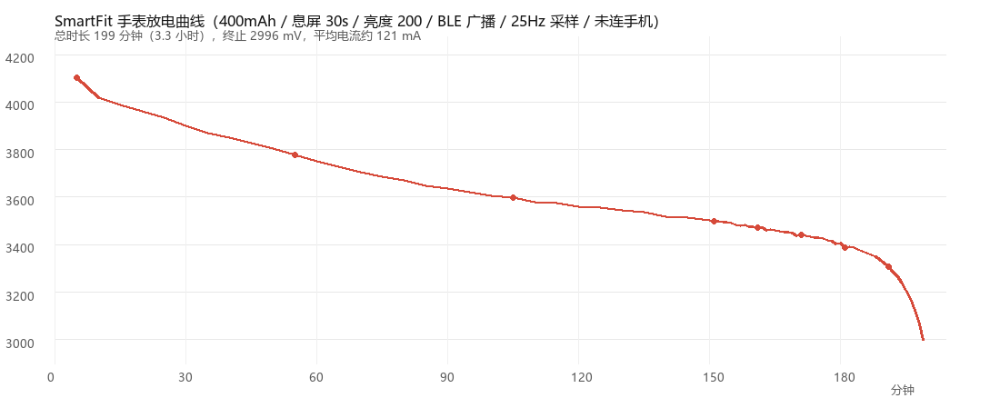

# 实验 E1：整机续航基线（放电曲线）

> 目的：回答"一次充电能用多久"——毕业设计三大系统级验收里的**功耗**一条。
> 这是**优化前的基线**，不是最终成绩。

---

## 1. 实验条件

| 项 | 值 |
| --- | --- |
| 日期 | 2026-11-23 19:00:07 拔线 → 2026-11-24 22:22 重新接上 |
| 电池 | 3.7 V 400 mAh（402728 软包） |
| 起始电压 | 4102 mV（充满，充电电流已降） |
| 屏幕 | 息屏 30 秒自动黑 |
| 亮度 | 200 / 255 |
| 采样 | 25 Hz 连续（息屏不停） |
| 蓝牙 | 广播中，**未连接手机** |
| 操作 | 全程未触碰（避免抬腕亮屏干扰） |
| 记录方式 | 固件每 5 分钟把 `分钟:mV` 写入 NVS；低于 10% 改 1 分钟一条 |

记录方式说明：拔掉 USB 后串口就断了，所以电压必须落 NVS（flash），
否则电池耗尽后数据全丢。这一点本身也是设计出来的（见 `pin-ledger.md` §15）。

---

## 2. 结果

| 指标 | 值 |
| --- | --- |
| **总续航** | **199 分钟（3 小时 19 分）** |
| 终止电压 | 2996 mV（AXP2101 欠压保护切断） |
| 平均电流 | ≈ **121 mA**（400 mAh ÷ 3.32 h） |
| 电压平台期 | 前 150 分钟从 4102 → 3450 mV |
| 陡降段 | 最后 50 分钟 3450 → 2996 mV |

原始数据：`docs/实验数据/放电-基线-20261123.csv`（79 个采样点）

---

## 3. 这个数字说明了什么

**3.3 小时对运动手表来说是不够的**——典型智能手表是 1～14 天。但这不是"做错了"，
而是**当前架构的必然结果**，而且原因可以逐项拆开：

| 子系统 | 估算电流 | 依据 |
| --- | --- | --- |
| ESP32-S3 @240MHz 常开（无 light sleep） | 35–45 mA | 双核空转 + 25Hz 采样 + 5000ms 统计 |
| BLE 广播（默认间隔） | 15–30 mA | 未连接时仍在广播 |
| AMOLED 面板 SLPIN | 20–40 mA | 只发了睡眠命令，面板与 QSPI 驱动仍供电 |
| 触摸轮询（息屏时 50ms 一次） | 1–2 mA | `touchWakeCheck()` 直接读 I2C |
| AXP2101 + QMI8658 + PCF85063 | 2–3 mA | 静态 |
| 合计 | **约 75–120 mA** | 与实测 121 mA 同量级 |

**关键结论：息屏 ≠ 省电。** 现在息屏只是让 LVGL 停止刷新（`flush avg=0us`，已在串口确认），
CPU、BLE、面板供电一个都没降。这是这台设备最值得优化的一处。

---

## 4. 误差与不可靠之处（写论文要主动交代）

1. **电池容量是标称值**：400 mAh 未实测，实际可能 ±10%
2. **单次测量**：只跑了一次，没有重复性验证
3. **`battPct` 不可信**：同一时刻 4103 mV 报 100%、3651 mV 报 1%，
   说明芯片的百分比估算很粗 —— 所以本文所有分析只用 mV，不用百分比
4. **终止点依赖保护板**：2996 mV 是 AXP2101 切断的电压，不是"电池真的没电"
5. **采样间隔 5 分钟**：末尾陡降（最后 20 分钟掉了 200 mV）可能有细节被漏掉，
   已通过"低于 10% 改 1 分钟"部分弥补

---

## 5. 下一步优化项（M4b）

按"改动小、收益大"排序：

| 优化项 | 预期收益 | 代价 |
| --- | --- | --- |
| 息屏时停 BLE 广播（重连时再开） | −15~25 mA | 手机要主动重连 |
| 息屏时 `esp_light_sleep`（采样任务改为定时唤醒） | −20~30 mA | 采样时序要重设计 |
| 息屏时把采样从 25 Hz 降到 5 Hz | −5~10 mA | 步数精度略降 |
| 面板真正断电（CO5300 deep standby） | −20~40 mA | 唤醒时间变长 |

若前两项能落地，**预期续航 8~12 小时**；这也是"优化前后对比"这一实验章节的核心素材。
